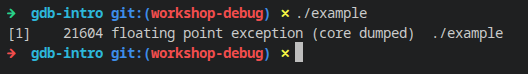
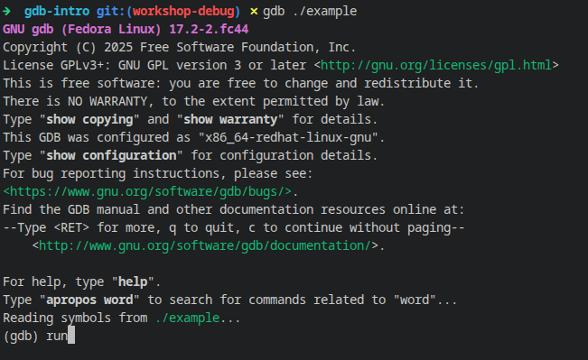
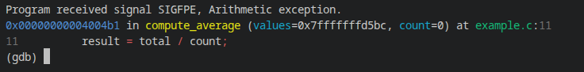
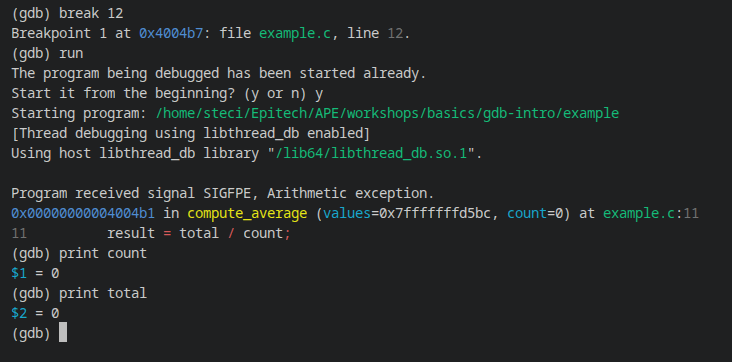
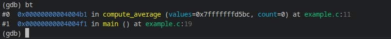
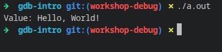
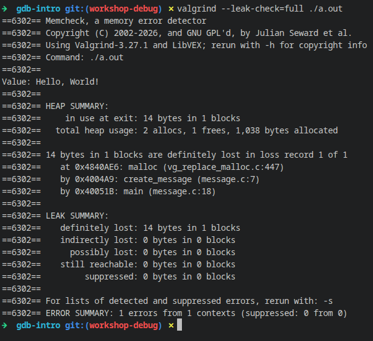
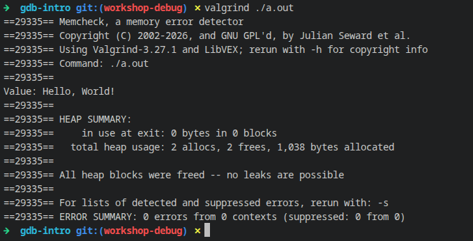

# **Atelier de Débogage**

Dans cet atelier, chaque exercice est un petit programme C qui contient **un bug**.
Votre mission est de **découvrir le bug**, de **déterminer quel outil utiliser (GDB ou Valgrind)**, puis de **le corriger**.

**La règle du jeu :** compilez le programme, puis **essayez de trouver le bug uniquement avec les outils**, sans lire le code source. Vous n'ouvrez le fichier `.c` que pour le corriger, une fois que vous savez *où* et *pourquoi* ça casse. C'est exactement ce que vous ferez plus tard sur des projets trop gros pour être relus ligne par ligne.

Ci-dessous se trouvent des **indices minimaux** destinés à vous guider sans révéler la solution.

---

## **C'est quoi, déboguer ?**

Un bug, c'est un écart entre ce que vous *pensez* que le programme fait et ce qu'il fait *vraiment*. Ajouter des `printf` partout fonctionne parfois, mais c'est lent et ça ne marche pas quand le programme plante avant d'afficher quoi que ce soit.

Deux outils vont vous aider :

* **GDB** (le *débogueur*) : il lance votre programme et vous permet de le **mettre en pause**, d'**avancer ligne par ligne** et de **regarder la valeur des variables** à n'importe quel moment. Idéal quand le programme **plante**.
* **Valgrind** : il surveille **toutes les utilisations de la mémoire** pendant l'exécution (`malloc`, `free`, lectures, écritures) et signale ce qui est incorrect, même si le programme ne plante pas. Idéal pour les **fuites** et les **accès mémoire invalides**.

Un peu de vocabulaire :

* **Point d'arrêt (breakpoint)** : une ligne où GDB mettra le programme en pause *avant* de l'exécuter.
* **Backtrace (pile d'appels)** : la liste des fonctions en cours, de la plus récente à `main`. Elle répond à la question *"comment suis-je arrivé ici ?"*.
* **Signal** : le message envoyé par le système quand le programme fait quelque chose d'interdit (`SIGSEGV` pour un accès mémoire invalide, `SIGFPE` pour une division par zéro, `SIGABRT` quand le programme s'arrête de lui-même suite à une erreur détectée).

---

## **Attention avant de commencer !!!**

Compilez **toujours** avec l'option `-g` quand vous déboguez :

```bash
gcc -g -o example example.c
```

`-g` ajoute dans le binaire les informations de débogage (noms des variables, numéros de ligne...). Sans elle, GDB et Valgrind ne pourront pas vous dire *à quelle ligne* se trouve le problème.

Dans le contexte du workshop, vous aurez uniquement les binaires !

---

## **Indices généraux pour tous les exercices**

* Si le programme **plante** (`Segmentation fault`, `Floating point exception`...), demandez-vous :
  - *"Dans quelle fonction et à quelle ligne ça plante ?"*
  - *"Quelles sont les valeurs des variables juste avant ?"*
  *(GDB est votre ami.)*

* Si le programme **ne plante pas** mais affiche des valeurs bizarres, ou utilise `malloc`/`free`, demandez-vous :
  - *"Est-ce que je lis ou j'écris dans une mémoire qui ne m'appartient pas ?"*
  - *"Est-ce que j'ai oublié de libérer de la mémoire ?"*
  *(Valgrind peut révéler des problèmes cachés.)*

* Si le programme **se bloque** (il ne rend jamais la main), demandez-vous :
  - *"Est-ce une boucle infinie, ou attend-il quelque chose qui n'arrivera jamais ?"*
  *(Lancez-le dans GDB, faites `Ctrl+C` pour le mettre en pause, puis `bt` pour voir où il en est.)*

* En cas de doute, essayez les deux et observez la sortie :

  ```bash
  gdb ./binary
  valgrind ./binary
  ```

* **Petite introduction**
   - Commandes GDB courantes (à taper après le `(gdb)`) :

     | Commande | Raccourci | Ce qu'elle fait |
     |---|---|---|
     | `run` | `r` | Lance le programme |
     | `break <ligne/fonction>` | `b` | Place un point d'arrêt (ex : `break 11` ou `break main`) |
     | `next` | `n` | Exécute la ligne courante **sans entrer** dans les fonctions appelées |
     | `step` | `s` | Exécute la ligne courante **en entrant** dans les fonctions appelées |
     | `print <variable>` | `p` | Affiche la valeur d'une variable |
     | `info locals` | | Affiche toutes les variables locales de la fonction courante |
     | `backtrace` | `bt` | Affiche la pile d'appels |
     | `list` | `l` | Affiche le code autour de la ligne courante |
     | `continue` | `c` | Reprend l'exécution jusqu'au prochain point d'arrêt |
     | `quit` | `q` | Quitte GDB |

     Astuce : appuyer sur `Entrée` sans rien taper répète la dernière commande (pratique pour enchaîner les `next`).

   - Options Valgrind courantes (à placer **avant** le nom du binaire) :
     - `--leak-check=full` : détaille chaque fuite de mémoire.
     - `--track-origins=yes` : indique d'où vient une valeur non initialisée.
     - `--show-leak-kinds=all` : affiche tous les types de blocs non libérés, y compris ceux encore accessibles.

    Et plus encore...!

* **Documentations**

    - [Documentation officielle de GDB](https://sourceware.org/gdb/documentation/)
    - [Documentation officielle de Valgrind](https://valgrind.org/docs/manual/quick-start.html)
    - Dans le terminal : `man gdb`, `man valgrind`, ou `help <commande>` directement dans GDB.

---

# **Exemple guidé n°1 (GDB)**

Avant de vous attaquer aux vrais exercices, parcourez cet exemple avec nous. Il montre l'*ensemble* du raisonnement, du début à la fin, sur un bug proche dans l'esprit de l'Exercice 1. Chaque exercice suivant vous demandera de reproduire cette même boucle par vous-même : **exécuter, observer, formuler une hypothèse, la confirmer avec un outil, corriger.**

Voici le code source du binaire `example` qui va nous servir (`example.c`) :

```c
#include <stdio.h>

int compute_average(int *values, int count)
{
    int total = 0;
    int result = 0;

    for (int i = 0; i < count; i++) {
        total += values[i];
    }
    result = total / count;
    return result;
}

int main()
{
    int values[] = {10, 20, 17};
    int count = 0;
    int avg = compute_average(values, count);

    printf("Average: %d\n", avg);
    return 0;
}
```

Le code est affiché ici uniquement pour que vous puissiez suivre le raisonnement : faites comme si vous ne l'aviez pas, et laissez les outils vous guider.

Compilez-le avec `-g` :

```bash
gcc -g -o example example.c
```

#### **Étape 1 - Reproduire le crash**

Commencez par l'exécuter simplement :



Notez la formulation exacte : `Floating point exception`. Malgré son nom ("virgule flottante"), ce message signifie presque toujours une **division entière par zéro**.

#### **Étape 2 - Choisir le bon outil**

Posez-vous les questions de la section Indices généraux :
- Est-ce que ça plante ? Oui -> GDB est le bon outil de départ.
- S'agit-il d'une fuite ou d'un comportement étrange sans plantage ? Non -> donc Valgrind n'est pas le premier choix ici.

Donc : **ce sera GDB.**

#### **Étape 3 - L'ouvrir dans GDB**

Lancez GDB en lui donnant le binaire, puis tapez `run` pour démarrer le programme :

```bash
gdb ./example
(gdb) run
```



Le programme tourne normalement jusqu'au crash. À ce moment-là, GDB le met en pause et affiche quelque chose comme :



Cette seule ligne vous en dit déjà beaucoup :
- **Quel signal** : `SIGFPE` (exception arithmétique), cela confirme notre hypothèse de division.
- **Quelle fonction** : `compute_average`.
- **Quelle ligne** : `example.c:11` - c'est la ligne `result = total / count;`.
- **Les valeurs des arguments au moment du crash** : `count=0`.

#### **Étape 4 - Confirmer l'hypothèse avec un point d'arrêt**

Même si le message de crash vous donne déjà `count=0`, il est bon de le vérifier vous-même plutôt que de faire confiance à une seule ligne de sortie. Placez un point d'arrêt sur la ligne du crash (la ligne 11) : GDB mettra le programme en pause **juste avant** d'exécuter cette ligne. Relancez avec `run` (GDB vous demande de confirmer le redémarrage, répondez `y`), puis inspectez les variables :

```
(gdb) break 11
(gdb) run
(gdb) print count
(gdb) print total
```



Cela confirme : `count` vaut `0`, et comme la boucle `for` ne s'exécute jamais quand `count` vaut `0` (la condition `i < count` est fausse dès le départ), `total` vaut aussi `0`. Le code s'apprête donc à calculer `0 / 0` - une division par zéro tout aussi fatale qu'une division d'un total non nul.

#### **Étape 5 - Trouver la cause profonde, pas seulement le symptôme**

Ne vous arrêtez pas à "count vaut 0 ici". Demandez-vous *pourquoi* il vaut 0. Utilisez `bt` (backtrace) pour voir comment `compute_average` a été appelée :



Se lit de haut en bas : `#0` est l'endroit où le programme s'est arrêté (`compute_average`, ligne 11), et `#1` est la fonction qui l'a appelée (`main`, ligne 19). Pour aller voir les variables de `main`, tapez `frame 1` puis `info locals`.

En regardant `main()` à la ligne 19, vous constateriez que `count` est simplement initialisé à `0` en dur (ligne 18 : `int count = 0;`), alors qu'il devrait refléter le nombre réel d'éléments du tableau `values` (ici 3 : `10`, `20`, `17`). Rien ne vérifie non plus, dans `compute_average`, que `count` est différent de zéro avant de diviser.

#### **Étape 6 - Corriger**

Il y a en réalité deux corrections complémentaires :

1. **Corriger la cause immédiate** dans `main()` : `count` doit correspondre au nombre réel de valeurs.
2. **Se prémunir dans `compute_average`** contre un `count` égal à zéro avant d'effectuer la division, pour que la fonction reste robuste même si elle est appelée avec un mauvais argument ailleurs dans le programme :

```c
int compute_average(int *values, int count)
{
    int total = 0;
    int result = 0;

    if (count == 0) {
        fprintf(stderr, "Error: no values provided\n");
        return 0;
    }

    for (int i = 0; i < count; i++) {
        total += values[i];
    }
    result = total / count;
    return result;
}
```

Et dans `main()` :

```c
int count = sizeof(values) / sizeof(values[0]);  // = 3, calculé automatiquement
```

Calculer la taille avec `sizeof` plutôt que d'écrire `3` en dur évite d'oublier de la mettre à jour si on ajoute une valeur au tableau.

#### **Étape 7 - Vérifier la correction**

Recompilez et relancez : le programme doit maintenant afficher `Average: 15`. Relancez-le aussi une fois dans GDB pour être sûr que le crash a bien disparu.

---

# Exemple guidé n°2 (Valgrind)

GDB est parfait pour les plantages. Mais certains bugs ne plantent jamais et se terminent "normalement" alors qu'ils sont défectueux, c'est typiquement le cas des fuites de mémoire. Ce deuxième exemple vous montre la boucle de raisonnement équivalente, mais avec Valgrind.

Voici le code source du binaire `message` qui va nous servir (`message.c`) :

```c
#include <stdlib.h>
#include <stdio.h>
#include <string.h>

char *create_message(const char *value)
{
    char *message = malloc(sizeof(char) * (strlen(value) + 1));

    for (int i = 0; value[i] != '\0'; i++) {
        message[i] = value[i];
    }
    message[strlen(value)] = '\0';
    return message;
}

int main()
{
    char *result = create_message("Hello, World!");

    printf("Value: %s\n", result);
    return 0;
}
```

C'est volontairement un programme très simple : `create_message` alloue de la mémoire sur le tas avec `malloc`, copie le message reçu caractère par caractère, puis renvoie le pointeur obtenu. Comme précédemment, le code est affiché ici uniquement pour suivre le raisonnement.

```bash
gcc -g -o message message.c
```

#### **Étape 1 - Reproduire le comportement**

Exécutez-le simplement :



Le programme affiche un message et se termine. Rien ne semble anormal à première vue. C'est précisément le piège : une fuite de mémoire ne se voit presque jamais à l'œil nu sur une exécution aussi courte - il faut un outil pour la révéler.

#### **Étape 2 - Choisir le bon outil**

Reposez-vous les questions de la section Indices généraux :

- Est-ce que ça plante ? Non -> donc GDB n'est pas la priorité ici.
- Est-ce que le programme alloue de la mémoire avec `malloc` ? Oui -> il est donc pertinent de vérifier avec Valgrind qu'elle est correctement libérée.

Bonne pratique générale : pour tout programme qui utilise `malloc`/`free`, passez-le sous Valgrind au moins une fois, même s'il semble fonctionner parfaitement.

#### **Étape 3 - Lancer Valgrind avec la vérification des fuites**

On met les options de Valgrind d'abord, puis le binaire à analyser :

```bash
valgrind --leak-check=full ./message
```

Valgrind exécute le programme (vous voyez toujours `Value: Hello, World!` au milieu) et affiche quelque chose comme :



Toutes les lignes qui commencent par `==6302==` viennent de Valgrind (le nombre est juste l'identifiant du processus, il changera chez vous). Les autres lignes sont la sortie normale de votre programme.

Ne regardez pas seulement le résumé final (`LEAK SUMMARY`) : la partie juste au-dessus, avec la mention `definitely lost` et la trace de pile, est ce qui vous intéresse le plus. Les `14 bytes` correspondent à la mémoire allouée par `malloc` et jamais libérée (13 caractères de `"Hello, World!"` + le `'\0'` final).

#### **Étape 4 - Lire la trace de pile pour trouver l'allocation coupable**

La trace se lit de haut en bas, comme une backtrace dans GDB :

```
at 0x4840AE6: malloc (vg_replace_malloc.c:447)   <- malloc a été appelé...
by 0x4004A9: create_message (message.c:7)        <- depuis create_message, ligne 7
by 0x40051B: main (message.c:18)                 <- elle-même appelée depuis main, ligne 18
```

Cela vous indique exactement où la mémoire a été allouée sans jamais être libérée : le bloc créé à la ligne 7 dans `create_message` est toujours alloué lorsque le programme se termine.

#### **Étape 5 - Trouver la cause profonde, pas seulement l'endroit**

Ne vous arrêtez pas à "il manque un `free()`". Demandez-vous : **qui est responsable de libérer cette mémoire ?**

Ici, `create_message` renvoie un pointeur vers une zone mémoire allouée dynamiquement. Une fois cette mémoire renvoyée, c'est à l'appelant (`main`) qu'appartient la responsabilité de la libérer lorsqu'il n'en a plus besoin.

#### **Étape 6 - Corriger**

Ajoutez le `free()` manquant, après la dernière utilisation du pointeur et avant de quitter `main` :

```c
#include <stdlib.h>
#include <stdio.h>
#include <string.h>

char *create_message(const char *value)
{
    char *message = malloc(sizeof(char) * (strlen(value) + 1));

    for (int i = 0; value[i] != '\0'; i++) {
        message[i] = value[i];
    }
    message[strlen(value)] = '\0';
    return message;
}

int main()
{
    char *result = create_message("Hello, World!");

    printf("Value: %s\n", result);
    free(result);
    return 0;
}
```

#### **Étape 7 - Vérifier la correction**

Recompilez puis relancez Valgrind, vous devriez maintenant voir :



La phrase à chercher est `All heap blocks were freed -- no leaks are possible`, avec `ERROR SUMMARY: 0 errors`.

---

# **Exercices**

Pour chaque exercice :

1. Compilez avec `-g`
2. Lancez le programme et observez ce qui se passe.
3. Choisissez l'outil (GDB ou Valgrind) en fonction de votre besoin (Il y a des indices si vous êtes perdu ou lever la main).
4. Trouvez la ligne fautive **avec l'outil**, puis ouvrez le `.c` pour comprendre et corriger.
5. Recompilez et vérifiez que le bug a disparu.

Les indices sont cachés et de plus en plus précis : n'ouvrez le suivant que si vous êtes vraiment bloqué.

---

# **Niveau Débutant (Fondamentaux)**

#### **Exercice 1**

Le plus proche de l'exemple guidé n°1 : reprenez les mêmes étapes, mais seul cette fois !

<details>
  <summary>Cliquez pour un indice</summary>

  Le programme plante avec `Floating point exception`.
Lancez-le dans GDB pour savoir dans quelle fonction et à quelle ligne.

<details>
  <summary>Besoin d'un indice de plus ? Cliquez ici ! :D</summary>
    Réfléchissez aux valeurs des variables juste avant que la division ne se produise.

<details>
  <summary>Encore un indice ? Mhh...</summary>
  Si une variable pouvait valoir zéro, que se passerait-il en divisant par elle ?

<details>
  <summary>Euh... Toujours perdu ? D:</summary>
  Placez un point d'arrêt sur la ligne de la division (`break <ligne>`), relancez avec `run`, puis affichez le diviseur avec `print`. Utilisez ensuite `bt` pour retrouver d'où vient cette valeur.
</details>
</details>
</details>
</details>

---

#### **Exercice 2**

<details>
  <summary>Cliquez pour un indice</summary>

  Le programme plante avec `Segmentation fault` : il a essayé d'accéder à une adresse mémoire interdite.
Le crash survient au moment où l'on déréférence un pointeur (`*ptr`). Inspectez ce pointeur juste avant l'échec.

<details>
  <summary>Besoin d'un indice de plus ? Cliquez ici ! :D</summary>
    Placez un point d'arrêt juste avant le déréférencement et affichez la valeur du pointeur.

<details>
  <summary>Encore un indice ? Mhh...</summary>
  À quoi ressemble un pointeur juste avant d'être utilisé, s'il n'a jamais reçu d'adresse valide ?

<details>
  <summary>Euh... Toujours perdu ? D:</summary>
  Exécutez le programme dans GDB, laissez-le planter, puis utilisez `bt` et `print` sur le pointeur. Si GDB affiche `0x0`, c'est que le pointeur vaut `NULL` : il ne pointe sur rien. Remontez dans `main` (`frame 1`) pour voir d'où il vient.
</details>
</details>
</details>
</details>

---

#### **Exercice 3**

<details>
  <summary>Cliquez pour un indice</summary>

  Le programme ne plante pas forcément, mais regardez bien sa sortie : la dernière valeur affichée est-elle normale ?
Un débogueur peut vous aider à voir quel index la boucle atteint.

<details>
  <summary>Besoin d'un indice de plus ? Cliquez ici ! :D</summary>
    Placez un point d'arrêt à l'intérieur de la boucle et observez la variable d'index à chaque itération.

<details>
  <summary>Encore un indice ? Mhh...</summary>
  Comparez la valeur finale atteinte par l'index à la taille réelle du tableau.

<details>
  <summary>Euh... Toujours perdu ? D:</summary>
  Utilisez `print i` (ou votre variable de boucle) à chaque `next`, ou placez un point d'arrêt conditionnel comme `break <ligne> if i >= size` pour capter précisément le dépassement. Rappel : un tableau de taille `N` a des cases numérotées de `0` à `N - 1`.
</details>
</details>
</details>
</details>

---

#### **Exercice 4**

Suivez la même boucle que dans l'exemple guidé n°2 (Valgrind), en l'adaptant : ici le programme ne fuit pas de mémoire, il **lit une valeur qui n'a jamais été correctement écrite**.

<details>
  <summary>Cliquez pour un indice</summary>

  Le programme affiche une valeur qui peut changer d'une machine à l'autre, ou d'une compilation à l'autre.
Un outil de suivi mémoire peut indiquer quelle variable n'a jamais été initialisée.

<details>
  <summary>Besoin d'un indice de plus ? Cliquez ici ! :D</summary>
    Exécutez le binaire sous Valgrind et examinez attentivement les avertissements qu'il émet, pas seulement le résumé final. Cherchez une ligne `Conditional jump or move depends on uninitialised value(s)`.

<details>
  <summary>Encore un indice ? Mhh...</summary>
  Une option spécifique de Valgrind est conçue pour tracer l'origine d'une valeur non initialisée.

<details>
  <summary>Euh... Toujours perdu ? D:</summary>
  Essayez `valgrind --track-origins=yes ./binary` et lisez la section `Uninitialised value was created by...` de la sortie : elle indique la fonction où se trouve la variable jamais initialisée. En C, une variable locale déclarée sans valeur (`int x;`) contient n'importe quoi.
</details>
</details>
</details>
</details>

---

# **Niveau Intermédiaire (Mémoire & Récursion)**

#### **Exercice 5**

<details>
  <summary>Cliquez pour un indice</summary>

  La fonction récursive fonctionnerait pour un nombre positif, mais le programme lui en donne un autre.
Suivez la pile d'appels étape par étape.

<details>
  <summary>Besoin d'un indice de plus ? Cliquez ici ! :D</summary>
    Placez un point d'arrêt au début de la fonction récursive et affichez l'argument à chaque appel.

<details>
  <summary>Encore un indice ? Mhh...</summary>
  Quelle valeur d'entrée devrait arrêter la récursion, et le code la vérifie-t-il réellement correctement ?

<details>
  <summary>Euh... Toujours perdu ? D:</summary>
  Avancez avec `step` (et non `next`) pour entrer dans chaque appel récursif, et observez comment l'argument évolue lorsqu'il est nul, négatif, ou autrement inattendu.
</details>
</details>
</details>
</details>

---

#### **Exercice 6**

<details>
  <summary>Cliquez pour un indice</summary>

  La pile d'appels grossit jusqu'à ce que le programme meure.
Regardez la backtrace une fois qu'il plante.

<details>
  <summary>Besoin d'un indice de plus ? Cliquez ici ! :D</summary>
    Exécutez le programme dans GDB et laissez-le planter, puis utilisez `bt` pour voir le motif des trames répétées.

<details>
  <summary>Encore un indice ? Mhh...</summary>
  Une fonction récursive a besoin d'une condition qui finit par l'arrêter. Cette condition est-elle jamais atteinte ?

<details>
  <summary>Euh... Toujours perdu ? D:</summary>
  La pile contient des dizaines de milliers d'appels : limitez l'affichage avec `bt 10` (les 10 plus récents) ou `bt -10` (les 10 plus anciens, près de `main`). Comparez l'argument transmis à chaque niveau pour comprendre pourquoi cela ne se termine jamais.
</details>
</details>
</details>
</details>

---

#### **Exercice 7**

Cet exercice suit exactement la boucle de l'exemple guidé n°2 ci-dessus. Reprenez chaque étape (exécuter, lancer Valgrind avec `--leak-check=full`, lire la trace de pile de l'allocation, corriger le).

<details>
  <summary>Cliquez pour un indice</summary>

  Le programme se termine normalement et n'affiche rien, mais de la mémoire n'est jamais libérée.
Un outil d'analyse mémoire peut lister les blocs non libérés.

<details>
  <summary>Besoin d'un indice de plus ? Cliquez ici ! :D</summary>
    Exécutez Valgrind avec la vérification complète des fuites activée et regardez la section "LEAK SUMMARY".

<details>
  <summary>Encore un indice ? Mhh...</summary>
  Chaque `malloc` devrait avoir un `free` correspondant. Quelle allocation n'en a pas ?

<details>
  <summary>Euh... Toujours perdu ? D:</summary>
  Utilisez `valgrind --leak-check=full ./binary` et lisez la trace de pile sous `definitely lost` : la ligne `by ... (fichier.c:N)` vous donne l'endroit exact de l'allocation.
</details>
</details>
</details>
</details>

---

#### **Exercice 8**

<details>
  <summary>Cliquez pour un indice</summary>

  Le programme lit une case de trop, juste après la fin du bloc alloué.
Il ne plante pas forcément, mais les outils peuvent vous dire exactement où.

<details>
  <summary>Besoin d'un indice de plus ? Cliquez ici ! :D</summary>
    Exécutez Valgrind et cherchez une erreur `Invalid read of size N` (N est le nombre d'octets lus : 4 pour un `int`).

<details>
  <summary>Encore un indice ? Mhh...</summary>
  Le message d'erreur de Valgrind inclut l'adresse exacte et de combien elle dépasse le bloc alloué. Faites correspondre cela à votre logique de boucle ou d'index.

<details>
  <summary>Euh... Toujours perdu ? D:</summary>
  Utilisez `valgrind ./binary` et lisez la ligne `Address ... is 0 bytes after a block of size ...` : "0 octet après" signifie que vous lisez juste après la fin du bloc. Le numéro de ligne de la lecture est donné dans la trace de pile juste au-dessus.
</details>
</details>
</details>
</details>

---

#### **Exercice 9**

<details>
  <summary>Cliquez pour un indice</summary>

  Le programme corrompt de la mémoire en dehors du bloc alloué.
Vérifiez les limites d'index.

<details>
  <summary>Besoin d'un indice de plus ? Cliquez ici ! :D</summary>
    Exécutez Valgrind et cherchez une erreur `Invalid write of size N` plutôt qu'une erreur de lecture.

<details>
  <summary>Encore un indice ? Mhh...</summary>
  Comparez la condition d'arrêt de la boucle au nombre réel d'éléments alloués pour le tampon.

<details>
  <summary>Euh... Toujours perdu ? D:</summary>
  Utilisez `valgrind ./binary` et notez le numéro de ligne de l'écriture invalide, puis placez un point d'arrêt GDB à cette ligne avec `break <ligne>` et affichez l'index et la taille du tampon côte à côte.
</details>
</details>
</details>
</details>

---

# **Niveau Avancé (Corruption de mémoire)**

#### **Exercice 10**

<details>
  <summary>Cliquez pour un indice</summary>

  Le programme a l'air de fonctionner... mais la valeur affichée en dernier est-elle fiable ?
Les outils mémoire peuvent montrer les accès à des blocs libérés.

<details>
  <summary>Besoin d'un indice de plus ? Cliquez ici ! :D</summary>
    Exécutez Valgrind et cherchez des erreurs `Invalid read` ou `Invalid write` mentionnant un bloc qui `was free'd`.

<details>
  <summary>Encore un indice ? Mhh...</summary>
  Trouvez où `free()` est appelé sur un pointeur, puis vérifiez chaque endroit où ce pointeur est utilisé par la suite.

<details>
  <summary>Euh... Toujours perdu ? D:</summary>
  La sortie de Valgrind montre deux traces de pile : où l'accès invalide a eu lieu, et où le bloc a été libéré. Comparez les deux pour trouver le pointeur qui a survécu à son allocation.
</details>
</details>
</details>
</details>

---

#### **Exercice 11 - Accès invalide après libération**

<details>
  <summary>Cliquez pour un indice</summary>

  Le bug se produit peu de temps **après** la libération d'un pointeur.
Quelqu'un l'utilise encore.

<details>
  <summary>Besoin d'un indice de plus ? Cliquez ici ! :D</summary>
    Placez un point d'arrêt GDB juste après l'appel à `free()` et observez ce qui arrive ensuite au pointeur.

<details>
  <summary>Encore un indice ? Mhh...</summary>
  Un pointeur libéré n'est pas automatiquement mis à NULL - le programme peut encore détenir une référence "pendante" vers lui.

<details>
  <summary>Euh... Toujours perdu ? D:</summary>
  Exécutez Valgrind pour obtenir la ligne exacte de l'accès ainsi que la ligne où le bloc a été libéré. Règle simple : après un `free(ptr)`, on ne touche plus jamais à `ptr`. Toute utilisation doit avoir lieu **avant** le `free`.
</details>
</details>
</details>
</details>

---

#### **Exercice 12**

<details>
  <summary>Cliquez pour un indice</summary>

  Le programme s'arrête avec un message du type `free(): double free detected` suivi de `Aborted`.
Les outils mémoire peuvent dire si un pointeur est libéré deux fois.

<details>
  <summary>Besoin d'un indice de plus ? Cliquez ici ! :D</summary>
    Exécutez Valgrind et cherchez un message d'erreur `Invalid free()`.

<details>
  <summary>Encore un indice ? Mhh...</summary>
  Retracez tous les chemins de code (y compris les branches de gestion d'erreurs) qui mènent à appeler `free()` sur le même pointeur.

<details>
  <summary>Euh... Toujours perdu ? D:</summary>
  Valgrind vous montrera deux traces de pile distinctes où `free()` a été appelé sur la même adresse. Une zone mémoire ne se libère qu'une seule fois : gardez un seul `free` par `malloc`.
</details>
</details>
</details>
</details>

---

#### **Exercice 13 - C'est quoi `memcpy` ?**

Attention, piège : ce programme peut afficher un résultat qui a l'air correct, et les outils ne détectent pas toujours ce bug. C'est un *comportement indéfini* : le résultat dépend de la machine et de la version de la bibliothèque C. Ici, c'est la lecture du manuel qui vous mènera à la solution.

<details>
  <summary>Cliquez pour un indice</summary>

  Le programme copie une partie d'un tableau... dans ce même tableau.
Une fonction mémoire spéciale évite ce problème.

<details>
  <summary>Besoin d'un indice de plus ? Cliquez ici ! :D</summary>
    Lisez `man memcpy`, en particulier la phrase sur les zones mémoire qui *overlap* (se chevauchent). Puis, dans GDB, affichez les adresses de la source et de la destination (`print &buffer[0]`, `print &buffer[3]`) et comparez-les à la taille copiée.

<details>
  <summary>Encore un indice ? Mhh...</summary>
  `memcpy` suppose que la source et la destination ne se chevauchent jamais. Quelle fonction de la bibliothèque standard est conçue pour gérer les régions qui se chevauchent en toute sécurité ?

<details>
  <summary>Euh... Toujours perdu ? D:</summary>
  On copie 6 octets de `buffer` vers `buffer + 3` : les octets 3 à 5 font partie à la fois de la source et de la destination. Selon votre machine, Valgrind peut le signaler avec `Source and destination overlap in memcpy`, ou ne rien dire du tout. Dans tous les cas, regardez `man memmove`.
</details>
</details>
</details>
</details>

---

#### **Exercice 14 - C'est quoi `realloc` ?**

Attention, piège : ce programme fonctionne parfaitement sur votre machine, et Valgrind ne trouvera probablement rien. Le bug n'apparaît que dans un cas rare. Ici, l'outil sert à *vérifier une hypothèse*, pas à trouver le bug à votre place.

<details>
  <summary>Cliquez pour un indice</summary>

  Le programme peut perdre de la mémoire si une réallocation échoue.
Vérifiez ce qui se passe quand `realloc` échoue (`man realloc`).

<details>
  <summary>Besoin d'un indice de plus ? Cliquez ici ! :D</summary>
    Placez un point d'arrêt juste après l'appel à `realloc()` et inspectez sa valeur de retour.

<details>
  <summary>Encore un indice ? Mhh...</summary>
  Si `realloc` échoue, il renvoie NULL mais ne libère *pas* le bloc d'origine. Que devient le pointeur d'origine dans le code s'il est directement écrasé ?

<details>
  <summary>Euh... Toujours perdu ? D:</summary>
  Utilisez GDB pour afficher (`print`) la valeur de retour de `realloc` juste après l'appel, et vérifiez si le code fait `ptr = realloc(ptr, ...)` directement - ce qui perd l'allocation d'origine en cas d'échec - plutôt que d'affecter d'abord à une variable temporaire.
</details>
</details>
</details>
</details>

---

#### **Exercice 15**

<details>
  <summary>Cliquez pour un indice</summary>

  Celui-ci est plus subtil : la fuite ne se produit que sur un chemin d'exécution réussi.
Examinez tous les blocs de mémoire alloués.

<details>
  <summary>Besoin d'un indice de plus ? Cliquez ici ! :D</summary>
    Exécutez Valgrind avec la vérification complète des fuites et comparez une exécution qui fuit à une exécution empruntant un chemin d'erreur.

<details>
  <summary>Encore un indice ? Mhh...</summary>
  Certaines allocations ne sont libérées que dans des branches de gestion d'erreurs. Le "chemin heureux" libère-t-il aussi tout ce qu'il a alloué ?

<details>
  <summary>Euh... Toujours perdu ? D:</summary>
  Utilisez `valgrind --leak-check=full --show-leak-kinds=all ./binary` spécifiquement sur le chemin d'exécution réussi, puis retracez la trace de pile de l'allocation pour voir si son `free()` correspondant n'existe que dans une branche qui n'est pas atteinte en cas de succès.
</details>
</details>
</details>
</details>

---

# **Niveau Expert (Threads & Concurrence)**

### Ces exercices sont vraiment dur pour des 1ères année. C'est normal si vous galérez.

Ces programmes utilisent des threads : ajoutez `-pthread` à la compilation (`gcc -g -pthread -o binary <fichier>.c`).

#### **Exercice 16 - Condition de course (Race Condition)**

<details>
  <summary>Cliquez pour un indice</summary>

  Exécuter le programme plusieurs fois donne des résultats différents, alors qu'on s'attend à `2000000`.
Inspectez les variables partagées entre threads.

<details>
  <summary>Besoin d'un indice de plus ? Cliquez ici ! :D</summary>
    Utilisez `info threads` dans GDB pour voir tous les threads en cours d'exécution, puis placez des points d'arrêt aux endroits où une variable partagée est lue ou écrite.

<details>
  <summary>Encore un indice ? Mhh...</summary>
  Deux threads ou plus accèdent peut-être à la même variable sans aucune synchronisation. Y a-t-il un mutex, ou devrait-il y en avoir un ?

<details>
  <summary>Euh... Toujours perdu ? D:</summary>
  Valgrind possède un outil dédié aux threads : `valgrind --tool=helgrind ./binary`. Cherchez `Possible data race` : il vous donne la variable et les deux lignes qui y accèdent en même temps. Réfléchissez ensuite à l'endroit où un `pthread_mutex_lock` / `pthread_mutex_unlock` manque.
</details>
</details>
</details>
</details>

---

#### **Exercice 17 - Interblocage (Deadlock)**

<details>
  <summary>Cliquez pour un indice</summary>

  Le programme ne répond plus mais ne plante pas.
Utilisez GDB pour vérifier ce qu'attend chaque thread.

<details>
  <summary>Besoin d'un indice de plus ? Cliquez ici ! :D</summary>
    Attachez GDB (ou interrompez avec Ctrl+C) pendant que le programme est bloqué, puis exécutez `info threads` pour voir où chaque thread est coincé.

<details>
  <summary>Encore un indice ? Mhh...</summary>
  Vérifiez la backtrace de chaque thread (`thread <n>` puis `bt`) pour voir quel verrou ou quelle ressource le bloque.

<details>
  <summary>Euh... Toujours perdu ? D:</summary>
  Si le Thread A attend un verrou détenu par le Thread B, et que le Thread B attend un verrou détenu par le Thread A, c'est une attente circulaire classique. Comparez l'ordre d'acquisition des verrous dans la backtrace de chaque thread pour trouver la discordance.
</details>
</details>
</details>
</details>

---

#### **Exercice 18 - Débordement de tampon (Buffer Overflow)**

<details>
  <summary>Cliquez pour un indice</summary>

  Le programme écrit plus de données que son tableau ne peut en contenir, et plante avec `Segmentation fault`.
Avez-vous bien lu les *warnings* affichés par `gcc` à la compilation ?

<details>
  <summary>Besoin d'un indice de plus ? Cliquez ici ! :D</summary>
    Attention : Valgrind ne détecte pas les débordements d'un tableau local (sur la pile), et la backtrace de GDB est inutilisable car la pile a été écrasée. Recompilez avec `gcc -g -fstack-protector-all` : le programme s'arrête alors avec `*** stack smashing detected ***`, et `run` puis `bt` dans GDB vous donnent la fonction fautive.

<details>
  <summary>Encore un indice ? Mhh...</summary>
  Comparez la taille des données écrites à la taille du tampon de destination. Les erreurs de type "off-by-one" sont des coupables fréquents.

<details>
  <summary>Euh... Toujours perdu ? D:</summary>
  Placez un point d'arrêt avant l'écriture, puis comparez `print sizeof(buffer)` et la longueur de la chaîne copiée dedans (sans oublier le `'\0'` final). Regardez aussi `man strncpy` et `man snprintf`.
</details>
</details>
</details>
</details>
